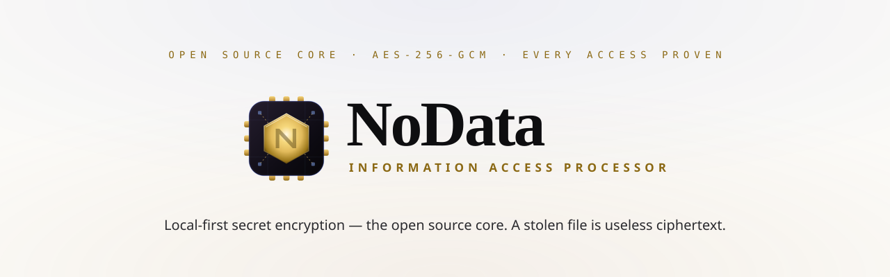
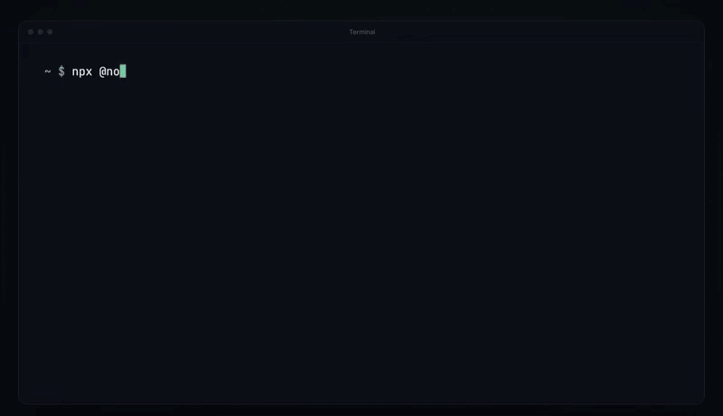

<div align="center">



**Don't trust NoData. Verify NoData.**

[](https://www.npmjs.com/package/@nodatachat/protect)

</div>

This repository is the source of [`@nodatachat/protect`](https://www.npmjs.com/package/@nodatachat/protect),
NoData's verification layer: the formats, their specs, test vectors, and the readable code
that checks them, and `agent-check`, which shows what your AI coding agent did on your
computer. It does not run NoData and makes no network calls.

Every version is published from this repository by GitHub Actions, with an npm
**provenance** attestation: npm shows which commit and which workflow built the package
you install, so you can read exactly the code you run.

## What did your AI agent touch?

```bash
npx @nodatachat/protect@3 agent-check       # the last 30 days; --lang he for Hebrew
```



<sub>A real run on one developer's computer: 30 days, 23,850 tool calls. The report holds counts only.</sub>

It reads the history Claude Code (`~/.claude/projects`) and Codex (`~/.codex/sessions`)
already keep on your computer, and counts, per category, what the agent **tried**, what
**succeeded**, and how many **secret-looking values came back** into its context. Credential
files, commands that print a credential, searches for passwords and keys, data files, and
commands that send data out. No install, no account, nothing sent: the report and the card
it writes hold numbers only, never a path, a command or a value. An attempt is not an
exposure, and a history that was deleted is not counted.

The rules are plain patterns in
[`packages/protect/src/agent-rules.ts`](packages/protect/src/agent-rules.ts) (from 3.7.0;
3.6.0 keeps them in `agent-history.ts`). Read them, and argue with them.

Step through real cases in the lab at **[whatmyagentsaw.com](https://whatmyagentsaw.com)**:
the evidence in each log, the limits of what it proves, and the decision these rules make.
The site is in [`site/`](site/) and is built from this repository, so it cannot drift from the code.

agent-check shows what already happened. Deciding what an agent may read next time, before
it reads it, is what [NoData](https://nodatacapsule.com) does.

## Verify NoData's claims

```bash
npx @nodatachat/protect@3 check-vectors     # the code matches the published formats
npx @nodatachat/protect@3 verify-pack pack.json
npx @nodatachat/protect@3 inspect-seal file.ndc
```

What each command proves, and what it does not, is in
[`packages/protect/README.md`](packages/protect/README.md) and the format specs next to it.

## What is here

| Path | What |
|---|---|
| [`packages/protect`](packages/protect) | `@nodatachat/protect` 3.x: specs, vectors, verifiers, and `agent-check`. License: [Apache-2.0](packages/protect/LICENSE.md) |
| [`legacy/`](legacy) | The 1.x open core (Apache-2.0), kept as published, not maintained |

NoData's product ([nodatacapsule.com](https://nodatacapsule.com): the server, the MCP, the SDK, the CLI, the read gate's decisions, the
deep scanner) is not in this repository. What is here is what you need to verify what
NoData says about it, and to see what your agent does before you decide what to allow.

To report a security issue, see [SECURITY.md](SECURITY.md).

## Build it yourself

```bash
cd packages/protect
npm ci && npm run build
node dist/bin.js check-vectors
```

The build output matches the published package file for file; compare with
`npm pack @nodatachat/protect@<version>`.
